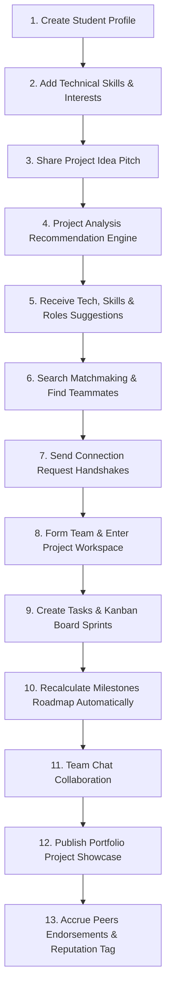

# 🚀 ProjectHub

> **Turn your idea into a project.**
> *Find the right people. Build together. Complete projects. Showcase your work.*

ProjectHub is a modern, student-focused project collaboration platform designed to help students transform raw project ideas into completed, real-world portfolio showcases. By connecting idea validation, automatic technology suggestion, recruitment matchmaking, workspace task tracking, and reputation score updates, ProjectHub provides a complete end-to-end journey for student project builders.

---

## 💡 How ProjectHub Works

ProjectHub streamlines the student collaboration workflow into a step-by-step lifecycle:



1. **Create your profile**: Sign up and choose your student credentials.
2. **Add skills and interests**: Specify technical capabilities (e.g. React, Python) and domains (e.g. AI, Climate Tech).
3. **Share your project idea**: Input your pitch, category, and preferred team size target.
4. **ProjectHub analyzes the idea**: The custom client-side recommendation engine drafts a project roadmap.
5. **Get technology recommendations**: Learn which frontend, backend, or design stacks align with your idea.
6. **Identify required skills**: Map out the exact list of engineering or design competencies needed.
7. **Get recommended team roles**: Define the positions (e.g., Lead Developer, Designer) required.
8. **Find suitable teammates**: Discover students whose profiles complement your project's empty roles.
9. **Send connection requests**: Initiate handshakes with potential classmates.
10. **Form a project team**: Accept invitations to lock in teammates.
11. **Open the project workspace**: Access active sprint controls, chats, and resources.
12. **Create and assign tasks**: Add cards to the Kanban backlog board and assign them.
13. **Track milestones**: Review automated roadmap check-offs calculated from completed tasks.
14. **Collaborate with teammates**: Chat in real-time within the workspace.
15. **Complete the project**: Bring the sprint progress to 100%.
16. **Publish the project showcase**: Compile problem details, screenshots, and live demo links.
17. **Build reputation through collaboration**: Receive verified peer endorsements.

---

## ⚡ The Problem & The Solution

| The Student Problem | The ProjectHub Solution |
| :--- | :--- |
| **Ideation Block**: Having an idea but lacking the expertise to structure it. | **Project Analysis Engine**: Automatically breaks pitches down into technical configurations and roadmaps. |
| **Matchmaking Struggles**: Finding suitable teammates with complementary technical skills. | **Find Teammates**: Double-blind discovery card system matching complementary frontend, backend, and design stacks. |
| **Team Formation Chaos**: Poor team formation leading to project abandonment. | **Connection Handshakes**: Formal bi-directional network verification that unlocks private chat spaces. |
| **Management Overhead**: Scattered tasks, poor planning, and out-of-sync roadmaps. | **Automated Workspace Sprints**: Interactive Kanban boards linked to automatic milestone completion trackers. |
| **Invisible Work**: Completed student code stays hidden, making recruitment hard. | **Project Showcase Portfolios**: Sleek visual draft publishing for finished projects, boosting reputation standings. |

---

## 🌟 Key Features

### 🎯 Project Idea Builder & Analysis
- **Analysis Engine**: Structures raw descriptions into difficulty rankings, tech stack suggestions, and recommended roles.
- **Wizard Setup**: Quick form validation covering category, target users, problem details, and duration options.

### 👥 Find Teammates & Connections
- **Complementary Matching**: Recommends developers or designers based on technical stacks.
- **Double-Blind Discovery**: Filter cards to find classmates, send connection request handshakes, and prevent duplicate requests.
- **Bi-directional Chats**: Chat lists unlock immediately when both students approve a handshake.

### 📋 Project Workspace & Sprints
- **Kanban Board**: Drag-and-drop or select statuses (`TODO`, `In Progress`, `Review`, `Done`) to update tasks.
- **Roadmap Milestones**: Dynamically computed completion percentages based on associated backlog cards, preventing out-of-sync progress.
- **Workspace Applications**: Allows owners to review pitches, verify candidate skills, and approve applicants.

### 🏆 Reputation & Showcases
- **Collaboration Score**: Numerical standings updated by peer ratings.
- **Peer Endorsements**: Track metrics for technical contribution, teamwork, and communication.
- **Portfolio Showcase**: Publish finished projects with screenshots, description details, live deployment paths, and GitHub repository links.

### 🔎 Discovery & Hackathons
- **Instant Global Search**: Categorized live search drop-down in the header querying projects, classmates, and hackathons.
- **Hackathon Collaborations**: Save upcoming hackathon events and launch teammate recruitment.

---

## 🛠️ Technology Stack

ProjectHub is built on a modern, typed, frontend-only stack:

*   **Framework**: [React 19](https://react.dev/)
*   **Language**: [TypeScript](https://www.typescriptlang.org/)
*   **Bundler & Dev Server**: [Vite 8](https://vite.dev/)
*   **Styling**: [Tailwind CSS 4](https://tailwindcss.com/)
*   **Icons**: [Lucide React](https://lucide.dev/)
*   **Routing**: [React Router Dom 7](https://reactrouter.com/)
*   **State Management**: React Context (`AppContext.tsx`)
*   **Persistence**: Synced client-side LocalStorage schema service (`storage.ts`)

---

## 📂 Project Structure

```bash
src/
├── components/          # Reusable shared UI widgets (Badge, Modal, Toast, Avatar, ProgressBar)
├── data/                # Initial student, project, hackathon, and community mock databases
├── features/            # Feature-scoped modules
│   ├── auth/            # Guest login, sign-up, and forgot password pages
│   ├── bookmarks/       # Bookmarked projects, hackathons, teammates, and ideas lists
│   ├── communities/     # Student community hubs
│   ├── dashboard/       # Action items, connections notifications, and recommendations
│   ├── matchmaking/     # Double-blind teammate discovery matching view
│   ├── messages/        # Bi-directional student chat spaces
│   ├── profile/         # Student bios, reputation tags, and endorsement modals
│   ├── projects/        # Discover boards, creation forms, details modal, and Workspace tabs
│   └── settings/        # Account details, avatar preset selectors, and passcode configs
├── layouts/             # Page structural layouts (MainLayout sidebar, AuthLayout)
├── services/            # Client storage and data retrieval helper functions
├── store/               # Relational state layer context hooks
├── types/               # App type models (Student, Project, Connection, Application)
├── App.tsx              # React Router core routing configuration
└── main.tsx             # Application entrance mounting script
```

---

## 📸 Screenshots

> [!NOTE]
> No media assets are currently committed to the git repository.
> Presets are loaded dynamically from Unsplash web routes. A future enhancement will include localized image screenshot assets.

---

## ⚙️ Getting Started

### Prerequisites
Make sure you have Node.js installed on your machine.

### Installation & Run

1. Clone the repository:
   ```bash
   git clone <repository-url>
   ```
2. Navigate to the project directory:
   ```bash
   cd project-hub
   ```
3. Install dependencies:
   ```bash
   npm install
   ```
4. Start the Vite development server:
   ```bash
   npm run dev
   ```
   *The application will launch locally at `http://localhost:5173/`.*

### Additional Commands
- **Build production bundle**:
  ```bash
  npm run build
  ```
- **Preview production build**:
  ```bash
  npm run preview
  ```

---

## 🔒 Data & Security

### Local-Persistence Prototype
ProjectHub currently utilizes a client-side database layer with relational tables synced directly inside `localStorage` (via [`storage.ts`](file:///c:/Users/pujit/Desktop/PROJECT-HUB/src/services/storage.ts)). This architecture simulates real databases and api states for instant, high-fidelity prototypes.

### Security Warning
This prototype is client-only. Password resetting, identity switching, and credentials caching should not be considered production-ready for real-world deployments. Input parameters are verified locally on submit.

---

## ♿ Accessibility

- Fully responsive CSS layout accommodating screen sizes from Mobile (vertical) up to Desktop.
- Native interactive input focus styles and keyboard-friendly selections.
- Readable fonts using curated visual color contrasts.

---

## 🛣️ Future Roadmap

- [ ] **Production Backend**: Transition relational hooks to a Node.js/Go API.
- [ ] **Database Integration**: Set up PostgreSQL or MongoDB schemas.
- [ ] **GitHub API Integration**: Read pull-request statistics and verify code contributions.
- [ ] **AI-Powered Recommendation Engine**: Integrate LLM APIs for automated project breakdown and teammate alignment.
- [ ] **Real-Time WebSockets Messaging**: Switch chats from local arrays to push notifications.

---

## 🤝 Contributing

1. Fork the repository
2. Create a feature branch (`git checkout -b feature/AmazingFeature`)
3. Commit your changes (`git commit -m 'Add some AmazingFeature'`)
4. Test the build (`npm run build`)
5. Push to the branch (`git push origin feature/AmazingFeature`)
6. Open a Pull Request

---

## 📝 License

Distributed under the MIT License. See `LICENSE` for more information.

---

## 👥 Authors

ProjectHub Contributors
