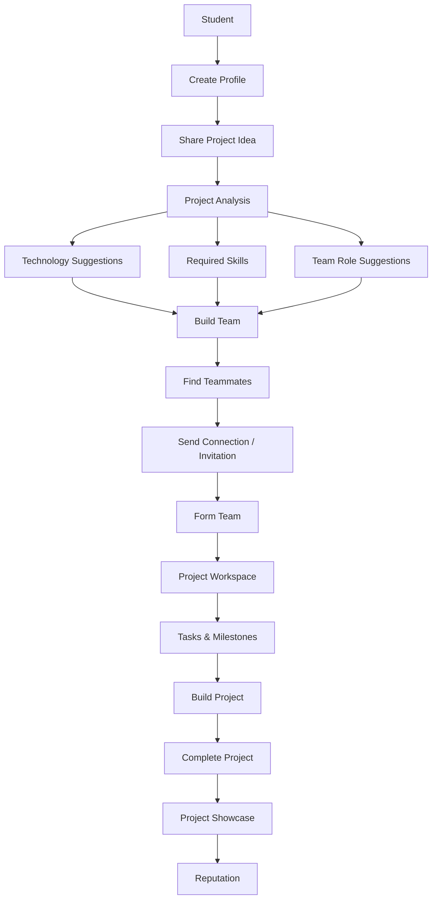

# 🚀 ProjectHub

### Turn Your Idea Into a Project

[](https://vite.dev/)
[](https://react.dev/)
[](https://www.typescriptlang.org/)
[](https://tailwindcss.com/)
[](https://reactrouter.com/)

ProjectHub is a student-focused project collaboration platform that helps students transform ideas into real projects by providing project guidance, technology recommendations, teammate discovery, team formation, project management, collaboration, and project showcasing.

---

## 📋 Table of Contents

- [Overview](#-overview)
- [Problem Statement](#-problem-statement)
- [Solution](#-solution)
- [Key Features](#-key-features)
- [Core Workflow](#-core-workflow)
- [System Architecture](#-system-architecture)
- [Application Architecture](#-application-architecture)
- [Technology Stack](#-technology-stack)
- [Main Modules](#-main-modules)
- [User Journey](#-user-journey)
- [Matching System](#-matching-system)
- [Project Management](#-project-management)
- [Data Flow](#-data-flow)
- [UI/UX Design](#-uiux-design)
- [Responsive Design](#-responsive-design)
- [Project Structure](#-project-structure)
- [Getting Started](#-getting-started)
- [Available Scripts](#-available-scripts)
- [Current Status](#-current-status)
- [Future Roadmap](#-future-roadmap)
- [Security](#-security)
- [Testing](#-testing)
- [Contributing](#-contributing)
- [License](#-license)
- [Author](#-author)

---

## 📌 Overview

ProjectHub is designed for students who want to build meaningful projects but struggle with finding teammates, choosing technologies, planning development, distributing work, and completing projects. The platform brings all of these lifecycle activities into a single cohesive web application.

The central concept connects each step of the student build process:

```
Student has an idea
        ↓
ProjectHub understands the idea
        ↓
ProjectHub suggests technologies and skills
        ↓
ProjectHub identifies required team roles
        ↓
Student finds suitable teammates
        ↓
Team is formed
        ↓
Project workspace is created
        ↓
Tasks and milestones are managed
        ↓
Team builds the project
        ↓
Project is completed
        ↓
Project is showcased
        ↓
Students build reputation
```

---

## 🎯 Problem Statement

Students commonly face several challenges when initiating projects outside of the structured classroom:

1. **Implementation Roadblock**: Students have great ideas but lack the software engineering structure to choose a tech stack or draft an implementation roadmap.
2. **Matchmaking Struggles**: Finding other students with complementary technical skills and shared domain interests is difficult.
3. **Collaboration Overhead**: Existing general-purpose tools (Discord, WhatsApp) are not designed around structured project tracking, boards, and milestones.
4. **Poor Responsibility Allocation**: Teams struggle to define explicit roles (Frontend, Backend, UI/UX) and map tasks to individual owners.
5. **No Milestones Tracking**: Tracking progress against deadlines and milestones is difficult without automated calculation structures.
6. **Isolated Showcase Portfolios**: Finished projects are left in private repositories, rather than visually presented.
7. **Lack of Peer Reputation**: Students have limited ways to build verified collaboration standing and obtain endorsements from previous teammates.

---

## 💡 Solution

ProjectHub addresses these problems with a unified, relational platform:

| Problem | ProjectHub Solution |
| :--- | :--- |
| **Don't know how to build an idea** | Project Analysis |
| **Can't find teammates** | Skill-based matchmaking |
| **Don't know required technologies** | Technology recommendations |
| **Don't know required roles** | Team role recommendations |
| **Difficult project management** | Tasks + Kanban + Milestones |
| **Poor collaboration** | Project workspace + messaging |
| **Hard to showcase projects** | Project Showcase |
| **No collaboration reputation** | Endorsements + Collaboration Score |

---

## ✨ Key Features

### 💡 1. Project Idea Builder
Students can submit a project idea using the multi-step Idea Builder Wizard, specifying:
* **Project Name**: The descriptive title.
* **Description**: The background context.
* **Problem**: The challenge being addressed.
* **Target Users**: The audience.
* **Category**: College project, hackathon, startup draft, etc.
* **Duration**: Estimated development timeline.
* **Team Size**: Targeted size.

### 🧠 2. Project Analysis
ProjectHub processes the idea and generates details including:
* **Summary Analysis**: The problem breakdown.
* **Difficulty target**: Beginner, Intermediate, or Advanced.
* **Estimated Duration**: Suggested timeframe.
* **Required Skills**: Specific developer skillsets needed.
* **Recommended Technologies**: Recommended frontend, backend, or database choices.
* **Team Roles**: Specific roles (e.g. Lead Engineer, UI/UX Designer) with filled/unfilled slots.
* **Development Roadmap**: Milestone stages mapped to tasks.
* *Note: ProjectHub currently uses a client-side recommendation engine for prototyping.*

### 👥 3. Teammate Discovery
* **Skill-based matching**: Matches students looking for specific empty roles with candidates having corresponding tags.
* **Availability & Interests**: Filters students based on college year, interests, and availability.
* **Collaboration score**: Displays other students' verified collaboration ratings.

### 🔗 4. Connection System
* **Send Request**: Initiate connection request handshakes with other student candidates.
* **Accept / Reject**: Approve or ignore incoming handshakes to unlock peer profiles.
* **Connected Status**: Automatically resolves network mapping to unlock chat communication.
* **Duplicate Prevention**: Prevents duplicate invites to active connections.

### 📋 5. Project Discovery
* **Browse Projects**: Discover projects looking for teammates.
* **Filters & Search**: Filter by category, target duration, tech stack, and text search query.
* **Apply / Join**: Direct join open slots or submit applications with pitch comments.
* **Bookmark**: Save projects of interest.

### 🧑🤝🧑 6. Team Builder
* **Required Roles**: View empty slots and current roster.
* **Teammates recommendations**: View recommended students matching roles.
* **Team Invitations**: Manage invites and applications in a single list.

### 📊 7. Project Workspace
An active project workspace divided into tabs:
* **Overview**: Project description, problem statement, tech configurations, and team rosters.
* **Tasks Board**: Kanban cards and sprint board columns.
* **Milestones**: Automated development timeline milestones.
* **Team Chat**: Real-time project room chat workspace.
* **Resources Cabinet**: Project files lists and simulation cabinets.
* **GitHub Link**: Link project workspaces to repositories.

### ✅ 8. Task Management
* **Kanban Columns**: Task statuses (`TODO`, `In Progress`, `Review`, `Done`).
* **Metadata**: Tasks feature deadlines, labels, priorities (Low, Medium, High), and assignees.
* **Automatic Progress**: Modifying task states automatically recalculates overall project progress.

### 🏆 9. Project Showcase
* **Showcase Portfolio**: Publish completed projects (100% progress) with screenshots, problem summaries, achievements, and live URLs.

### ⭐ 10. Reputation
* **Collaboration Score**: peer rating scores starting from 90 baseline.
* **Endorsements**: Categories like Technical Contribution, Teamwork, and Communication.

### 🔔 11. Notifications
* Live header notification bell with indicators for connection requests, applications, and task completions.

### 🏆 12. Hackathon Discovery
* Explore hackathons, bookmark events, and coordinate teammate recruitment.

### 💬 13. Messaging
* Chat workspace for connected peers, unlocking communications channels.

---

## 🔄 Core ProjectHub Workflow



---

## ⚙️ System Architecture

ProjectHub is designed as a standalone SPA (Single Page Application) with a decoupled client-side data layer. 

```
┌────────────────────────────────────────────────────────┐
│                      User Browser                      │
│                                                        │
│   ┌───────────────┐   ┌───────────────┐   ┌────────┐   │
│   │  Vite React   │ ──│  React Router │ ──│ CSS    │   │
│   │  Components   │   │  Controllers  │   │ Layout │   │
│   └───────────────┘   └───────────────┘   └────────┘   │
│           │                                            │
│           ▼                                            │
│   ┌────────────────────────────────────────────────┐   │
│   │              AppContext Provider               │   │
│   │      (Central Relational State Manager)        │   │
│   └────────────────────────────────────────────────┘   │
│           │                                            │
│           ▼                                            │
│   ┌────────────────────────────────────────────────┐   │
│   │            Storage Service Wrapper             │   │
│   │    (Handles JSON Parsing & Serialization)      │   │
│   └────────────────────────────────────────────────┘   │
└───────────┼────────────────────────────────────────────┘
            │
            ▼
┌───────────────────────┐
│     LocalStorage      │
│   (Relational JSON)   │
└───────────────────────┘
```

* **Routing Layer**: Manages protected dashboard paths and guest routes via React Router 7.
* **State Management**: Orchestrates updates across collections using React Context.
* **Persistence Layer**: Handles serialization and data retrieval to keep dashboard changes intact upon page refreshes.

---

## 📂 Application Architecture

ProjectHub's features are isolated into modular modules matching typical student workflows:

```
┌─────────────────────────────────────────────────────────────────────────┐
│                           PROJECTHUB MODULES                            │
│                                                                         │
│   ┌─────────────────┐   ┌───────────────────┐   ┌───────────────────┐   │
│   │   Auth Module   │   │ Dashboard Module  │   │ Matchmaking view  │   │
│   │  Login/Sign-up  │   │  Alerts/Overview  │   │   Team Builder    │   │
│   └─────────────────┘   └───────────────────┘   └───────────────────┘   │
│                                                                         │
│   ┌─────────────────┐   ┌───────────────────┐   ┌───────────────────┐   │
│   │ Discover Module │   │ Workspace Module  │   │ Reputation Module │   │
│   │  Projects Board │   │  Kanban & Roadmap │   │ Peer Endorsements │   │
│   └─────────────────┘   └───────────────────┘   └───────────────────┘   │
│                                                                         │
│   ┌─────────────────┐   ┌───────────────────┐   ┌───────────────────┐   │
│   │  Bookmarks Tab  │   │ Messages Channels │   │ Hackathons Module │   │
│   │   Teammates/Id  │   │  Direct & Teams   │   │  Save/Recruitment │   │
│   └─────────────────┘   └───────────────────┘   └───────────────────┘   │
└─────────────────────────────────────────────────────────────────────────┘
```

---

## 🛠️ Technology Stack

* **Vite 8**: Frontend compiler.
* **React 19**: Frontend UI rendering framework.
* **TypeScript 6**: Typed interface bindings.
* **Tailwind CSS 4**: Stylings.
* **Lucide React**: Vector icon indicators.
* **React Router Dom 7**: Dynamic client-side layout paths.
* **LocalStorage System**: Local key-value database persistence.

---

## 📦 Main Modules

1. **Dashboard**: Central dashboard detailing action notifications, greeting indicators, active sprint summaries, recommendation summaries, and pending connection approvals.
2. **Discover Projects**: Search workspace containing filters, browse cards, project details modal, apply Pitch forms, and bookmark triggers.
3. **My Projects / Workspace**: Kanban board manager, file simulators, auto-calculated milestone timelines, team chats, and application approvals.
4. **Team Builder**: Relational discovery card list sorting peer student options for connection requests.
5. **Hackathons**: Discover upcoming hackathons, bookmark events, and launch teammate recruitment.
6. **Messages**: Bi-directional chat channels unlocked for active connection handshakes.
7. **Reputation Profile**: Details peer student skills, course histories, achievements, and endorsement parameters.
8. **Bookmarks**: Saved cards grouped by projects, hackathons, teammates, and ideas.
9. **Settings**: Edit inputs synchronizing student details, avatar photo presets, passcodes, and push configurations.

---

## 👤 User Journey

A student's interaction path is mapped below:

1. **Authentication**: Sign up as a new student or log in as a mock user (e.g. Pujitha).
2. **Profile Setup**: Visit Settings to select an avatar preset and update details.
3. **Idea Generation**: Draft a project idea in the Wizard and receive analysis engine recommendations.
4. **Team Search**: View recommended teammates under Find Teammates and initiate connection handshakes.
5. **Team Roster Verification**: Switch identities to accept connections, form teams, and assign Kanban cards.
6. **Sprint Tracking**: Move task cards to `Done` in the workspace to automatically recalculate roadmap milestones.
7. **Project Completion**: Publish completed projects to reputation portfolios.

---

## 🧠 Matching System

The teammate recommendation algorithm evaluates compatibility based on skill and role alignments:

```
Inputs: Student technical skill tags + Project vacancy role skill tags
             │
             ├─► 1. Identify roles where filled < role target count.
             ├─► 2. Match student skills (e.g. React) with role requirements.
             ├─► 3. Evaluate matching college cohorts and domains.
             ▼
Output: compatibility list sorted by matching metrics percentage.
```

---

## 📋 Project Management

Tasks on the Kanban Board drive automated progress metrics:

* **Task Status Hierarchy**: `TODO` ➔ `In Progress` ➔ `Review` ➔ `Done`.
* **Progress Recalculation**: Overall progress is computed as:
  $$\text{Progress} = \left( \frac{\text{Completed Tasks}}{\text{Total Tasks}} \right) \times 100$$
* **Milestone Automation**: Milestones map to task IDs and are checked off automatically when all associated tasks are marked as `Done`.

---

## 🔄 Data Flow

Updates flow through a unidirectional state model:

```
Component Action (e.g., Complete Task)
        │
        ▼
useApp Hook Action Trigger
        │
        ▼
State Reducer recalculates task list & milestone ratios
        │
        ▼
AppContext updates projects state array
        │
        ▼
Vite React Components re-render
        │
        ▼
storage.set stores updated JSON in LocalStorage
```

---

## 🎨 UI/UX Design

The application adheres to clean, modern, student-focused web patterns:
* **Typography**: Highly readable fonts.
* **Palette**: Sleek slate backgrounds paired with professional primary blue accents.
* **Micro-interactions**: Subtle hover state transitions on action cards.
* **No Cyberpunk Elements**: Uses visual hierarchy, avoiding excessive neon glows or cyberpunk styling.

---

## 📱 Responsive Design

Supports layouts across multiple screen sizes:
* **Mobile Devices (< 768px)**: Collapsible hamburger menus, sticky bottom navigation bars, and single-column lists.
* **Tablets (768px - 1024px)**: Adaptive grid structures and tabbed workspace menus.
* **Desktop Monitors (>= 1024px)**: Fixed double-sidebar grids.

---

## 📂 Project Structure

```bash
src/
├── components/          # Reusable shared UI widgets (Badge, Modal, Toast, Avatar, ProgressBar)
├── data/                # Initial student, project, hackathon, and community mock databases
├── features/            # Feature-scoped modules
│   ├── auth/            # Guest login, sign-up, and forgot password pages
│   ├── bookmarks/       # Bookmarked projects, hackathons, teammates, and ideas lists
│   ├── communities/     # Student community hubs
│   ├── dashboard/       # Action items, connections notifications, and recommendations
│   ├── hackathons/      # Hackathon event boards and team find triggers
│   ├── idea/            # Multi-step Idea Generator Wizard
│   ├── matchmaking/     # Double-blind teammate discovery matching view
│   ├── messages/        # Bi-directional student chat spaces
│   ├── profile/         # Student bios, reputation tags, and endorsement modals
│   ├── projects/        # Discover boards, creation forms, details modal, and Workspace tabs
│   └── settings/        # Account details, avatar preset selectors, and passcode configs
├── layouts/             # Page structural layouts (MainLayout sidebar, AuthLayout)
├── services/            # Client storage and data retrieval helper functions
├── store/               # Relational state layer context hooks
├── types/               # App type models (Student, Project, Connection, Application)
├── App.tsx              # React Router core routing configuration
└── main.tsx             # Application entrance mounting script
```

---

## ⚙️ Getting Started

### Prerequisites
Make sure you have Node.js installed on your machine.

### Installation

1. Clone the repository:
   ```bash
   git clone <repository-url>
   ```
2. Navigate to the project directory:
   ```bash
   cd project-hub
   ```
3. Install dependencies:
   ```bash
   npm install
   ```
4. Start the Vite development server:
   ```bash
   npm run dev
   ```
   *The application will launch locally at `http://localhost:5173/`.*

---

## 📜 Available Scripts

In the project directory, you can run:

- `npm run dev`: Starts the local development server.
- `npm run build`: Compiles the TypeScript code and bundles the project.
- `npm run preview`: Previews the production build locally.
- `npm run lint`: Runs code linter validations.

---

## 🚧 Current Status

ProjectHub is currently an actively developed prototype. Fully working frontend features include:
* Student profiles and settings.
* Project idea building and analysis recommendations.
* Connection request handshakes and peer chats.
* Workspace Kanban boards and automated milestones.
* Bookmark lists and header notifications.

---

## 🛣️ Future Roadmap

- [ ] **Production Backend**: Transition relational hooks to a Node.js/Go API.
- [ ] **Database Integration**: Set up PostgreSQL or MongoDB schemas.
- [ ] **GitHub API Integration**: Read pull-request statistics and verify code contributions.
- [ ] **AI-Powered Recommendation Engine**: Integrate LLM APIs for automated project breakdown and teammate alignment.
- [ ] **Real-Time WebSockets Messaging**: Switch chats from local arrays to push notifications.

---

## 🔒 Security

* **Prototype Disclaimer**: Since this application runs purely on client-side state, user passwords and sessions are simulated.
* **Future Security Milestones**: Implementation of JWT session validations, password crypt hashing, and server-side rate limits.

---

## 🧪 Testing

* Run TypeScript compilation checks prior to deployment:
  ```bash
  npx tsc --noEmit
  ```

---

## 🤝 Contributing

1. Fork the repository
2. Create a feature branch (`git checkout -b feature/AmazingFeature`)
3. Commit your changes (`git commit -m 'Add some AmazingFeature'`)
4. Test the build (`npm run build`)
5. Push to the branch (`git push origin feature/AmazingFeature`)
6. Open a Pull Request

---

## 📝 License

Distributed under the MIT License.

---

## 👥 Author

ProjectHub Contributors
